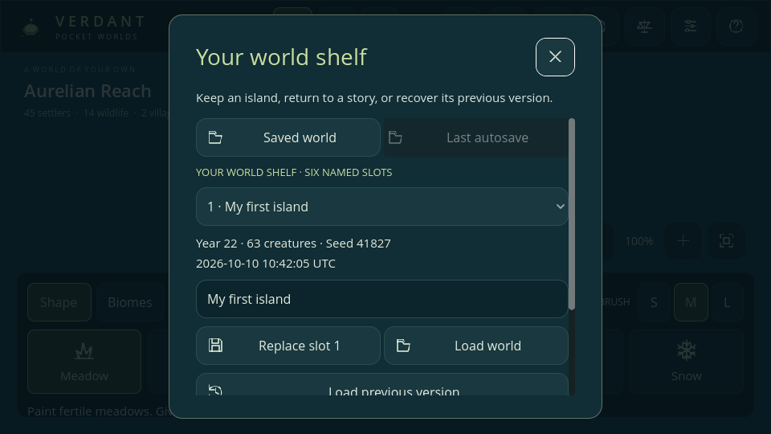

# Verdant — Pocket Worlds

A small world, in your hands. An original **Godot 4.6.3** mobile-first god sandbox inspired by the systems in the supplied research document. Shape an island, introduce life, let a village emerge, and change its fate.

**Current milestone: Phase 8 editor beta, v0.8.0.** This is a running game prototype, with a roadmap for the larger civilization simulation. The title is a working name.



## Play

1. On GitHub, choose **Code → Download ZIP**, then extract the entire project.
2. Install the **standard Godot 4.6.3 editor**; the .NET edition is unnecessary.
3. In Godot Project Manager, choose **Import**, select the extracted `project.godot`, and allow the assets to import.
4. Press **F5** to run. Use the sliders icon for sound/reading settings, the world shelf for saves, and `?` for the field guide.

**No Android SDK, APK, AAB, export templates, Python, or account is needed to play in the editor.** See [the Godot testing checklist](docs/GODOT_TESTING.md). Mobile packages are intentionally deferred until after editor feedback.

On Linux or in the prepared cloud workspace:

```sh
./tools/godot.sh --editor   # Open the editor with writable local cache directories.
./tools/godot.sh            # Run the game when a graphical display is available.
./tools/check.sh            # Import, model tests, scene tests, and startup smoke test.
```

Set `GODOT_BIN=/path/to/godot` if the executable is named differently. There are no runtime packages, accounts, servers, or network requirements. Python and Pillow are needed **only** to regenerate the committed art.

## What is playable

- Seeded 144 × 96 continents, archipelagos, and a Frontier continent with three peoples; optional starter population.
- Six terrain presets plus independent temperate, woodland, arid, wetland, tundra, and glimmergrove biome brushes.
- Three brush sizes, continuous strokes, camera pan, zoom, and fit-to-world.
- Settlers, rabbits, and deer: movement, foraging, hunger, reproduction, aging, and death.
- Villages with finite wood/stone, visible gathering and hauling, real stores, growing crops, paid house construction, and housing/food limits on births.
- Shared A* navigation around barriers; terrain edits update routes; a local spatial index supports creature searches.
- Kingdoms with stable ownership, rulers, succession, overland colony expeditions, loyalty, independence, and collapse.
- Political borders, a live kingdom inspector, alliances/rivalry, and favor/peace/discord interventions.
- Declared wars, recruited villagers with bows/spears, paid watchtowers, morale, retreat, settlement capture, and physical transport boats.
- A War dashboard with supplies, orders, and a camera shortcut to follow soldiers.
- Data-driven species, inherited traits and appearance, rare mutations, habitat adaptations, and named subspecies.
- A live Lives inspector with parents/children, generations, favorites, and personal memories that remain after death.
- A live village dashboard with jobs, stores, construction, and 120 years of population history.
- Rain, drought, snowfall, storms, seasonal temperature, and world ages with growth and food effects.
- Rustfever transmission, recovery, immunity, and readable environmental inspection.
- Rain/fire/blessing/meteor powers plus lightning, earthquakes, finite volcanoes, and plague.
- Cultures, social clans, languages, and hearth faiths with practical learning, loyalty, and healing effects.
- Crop rotation and masonry learned through real work; connected communities exchange knowledge and migrants gradually adopt traditions.
- Society inspection, remembered ruler timelines, history filters, population/resource graphs, and four discovery emblems.
- Pause and 1× / 2× / 5× time; fourteen configurable world laws and three presets.
- Creature/tile/village inspection, village rings, population counts, and a world chronicle.
- Six named world slots, quick save, and autosave, each with a previous valid backup; recovery from damaged/interrupted writes and preservation before loading another world.
- Persistent volume, larger reading text, higher contrast, reduced motion, focus-pause, and 30/60 FPS limit settings.
- Four original local audio assets, including gentle looping ambience and interaction cues.
- Terrain textures updated in bounded chunks instead of rebuilding the full map after every local change.
- Validated v7 JSON world loading, all genuine Phase 1–7 compatibility fixtures, and autosave on application suspension.
- Landscape phone layout, two-finger pan/pinch, desktop mouse/keyboard support, and original pixel/vector assets.

Advanced social/genetic editors, naval combat, possession, and larger achievement collections remain future work. Roads and walls await navigation profiling.

## Controls

| Action | Touch | Desktop |
| --- | --- | --- |
| Apply selected tool | Tap or drag | Left click or drag |
| Move | One finger with Move selected; two fingers with any tool | Move + left drag; right/middle drag with any tool |
| Zoom | Pinch or + / − | Wheel or + / − |
| Inspect | Inspect, then tap | Inspect, then click; `I` selects tool |
| Pause/resume | Pause button | Pause button or `Space` |
| Move tool | Crossed-arrow button | `V` |
| Save | Save icon | Save icon or `Ctrl/Cmd+S` |
| Close a panel | × | × or `Esc` |

Try **New world → Frontier continent · three peoples**. Use **Observe → Borders** and **Kingdoms** to follow rulers, expansion, and diplomacy. **Observe → Villages** shows the local economy. In Kingdoms → Diplomacy, **Declare war** mobilizes settlements when supplies allow; the **War** tab shows their companies. **Make peace** ends the selected war and sends survivors home. Inspect a creature, then open **Observe → Lives** to discover its traits, navigate its family, or save it as a favorite.

**Biomes** changes ecology while preserving coasts and homes. Inspect land, then open **Observe → Planet** to see temperature, moisture, and growth, call weather, select a world age, or apply a law preset. New systems start paused when loading an older save; choose **Living planet** to enable them.

There is no win condition. Try placing four settlers near each other, waiting for a village, then cutting a channel through its surroundings. Or turn off fire spread and compare what a single flame does.

## Saves

Godot writes `world.json`, `autosave.json`, and six named files under `worlds/` to `user://`. Valid replacements retain one `.bak`; a complete `.tmp` may recover an interrupted first save. Settings live separately in `settings.json`. The wrapper defaults to `.local/data/godot/app_userdata/Verdant — Pocket Worlds/` inside this checkout on Linux; a direct editor launch uses Godot's standard OS location instead. Use the same launch method to see the same saves.

Autosave runs every 60 seconds during play, including the live village and kingdom dashboards, and on mobile application suspension. **Open the world shelf to restore a previous world.** Launch starts a fresh demonstration world. Loading or creating a world first preserves the current one in autosave. Ctrl+S updates the active named slot; starting a new world resets it to the separate quick-save file. Save files and caches are ignored by Git.

## Development documents

- [Godot editor testing and feedback](docs/GODOT_TESTING.md)
- [Saves, settings, audio, and Phase 8 beta rules](docs/BETA.md)
- [Cultures, clans, knowledge, faiths, and Phase 7 rules](docs/SOCIETY.md)
- [Biomes, climate, disease, and Phase 6 rules](docs/ENVIRONMENT.md)
- [Heredity, traits, families, and Phase 5 rules](docs/HEREDITY.md)
- [War, defense, capture, transport, and Phase 4 rules](docs/WARFARE.md)
- [Phased roadmap and acceptance gates](ROADMAP.md)
- [Kingdoms, expansion, diplomacy, and Phase 3 rules](docs/POLITICS.md)
- [Village economy and Phase 2 mechanics](docs/ECONOMY.md)
- [Game design and current mechanics](docs/GAME_DESIGN.md)
- [Architecture and extension points](docs/ARCHITECTURE.md)
- [Android / iOS export and device testing](docs/MOBILE.md)
- [Verification and known limitations](docs/TESTING.md)
- [Art direction, regeneration, and attribution](docs/ART.md)
- [Original user-provided research](docs/reference-design.txt)

**Platform status:** the Linux Godot project has been run and rendered in the cloud environment. Touch input is covered by synthetic gesture tests. No Android APK, iOS archive, store upload, or physical-device certification is claimed.
