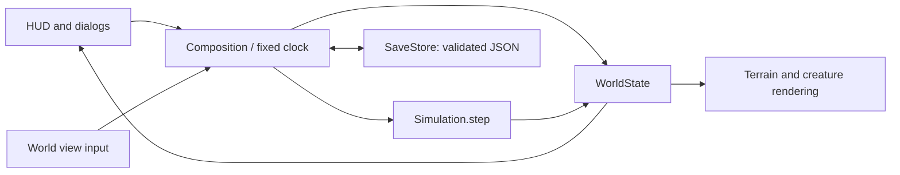

# Architecture and development

## Layout

```text
project.godot                 engine, renderer, orientation, viewport configuration
scenes/main.tscn              root scene
scripts/main.gd              composition, fixed-step clock, menus, persistence flow
scripts/model/world_state.gd data, world generation, painting, powers, spawning
scripts/model/simulation.gd  environment, survival, reproduction, fixed step order
scripts/model/village_economy.gd work, reservations, farms, construction, stocks
scripts/model/world_navigation.gd shared A* grid and connected components
scripts/model/spatial_index.gd local creature queries
scripts/model/kingdom_politics.gd realms, rulers, claims, diplomacy, expeditions
scripts/model/politics_persistence.gd v3 validation and political migration
scripts/model/military_simulation.gd recruitment, combat, defense, capture, orders
scripts/model/sea_transport.gd boarding, bounded water search, sailing, landing
scripts/model/military_persistence.gd v4 validation and military migration
scripts/model/species_definition.gd typed species Resource
scripts/model/species_catalog.gd trusted data/species/*.tres registry
scripts/model/heredity.gd genomes, derived traits, family records, favorites
scripts/model/heredity_persistence.gd v5 validation and legacy migration
scripts/model/biome_catalog.gd ecosystem growth/temperature/resource tables
scripts/model/environment_simulation.gd climate, vegetation, disease, finite hazards
scripts/model/environment_persistence.gd v6 validation and restoration
scripts/model/society_simulation.gd learned identity, knowledge, adoption, history
scripts/model/society_persistence.gd v7 social validation and restoration
scripts/model/save_store.gd  versioned JSON serialization and input validation
scripts/model/safe_files.gd  validated JSON replacement, backup and recovery
scripts/model/save_library.gd six named world slots and metadata
scripts/model/player_settings.gd validated, separately persisted preferences
scripts/ui/world_view.gd     canvas rendering, camera, touch/mouse handling
scripts/ui/terrain_chunks.gd bounded dirty terrain image/texture cache
scripts/ui/game_audio.gd     local ambience and interaction audio
scripts/ui/game_hud.gd       responsive controls, live stats, inspector, chronicle
scripts/ui/save_library_panel.gd named save/load and previous-version controls
scripts/ui/settings_panel.gd audio, reading, motion, focus and frame preferences
scripts/ui/village_panel.gd  live village dashboard
scripts/ui/population_chart.gd yearly population/capacity chart
scripts/ui/kingdom_panel.gd  Realm/Diplomacy/War/Chronicle inspector and interventions
scripts/ui/military_panel.gd company supplies, orders, defense, and camera focus
scripts/ui/life_panel.gd     live Traits/Family/Memories browser
scripts/ui/environment_panel.gd live Climate/Land/Health inspector
scripts/ui/society_panel.gd People/Knowledge/History/Discoveries inspector
scripts/ui/society_chart.gd yearly population and resource series
data/species/               original species resource definitions
assets/                     committed original sprites/icons and licensed fonts
tests/                      headless simulation and scene integration checks
tools/                      local engine wrapper, validation, assets, screenshots
docs/                       design, roadmap support, device/export notes
```

Model objects are `RefCounted`, with no node or rendering dependency. UI objects are ordinary `Control`s. There is one world canvas; there is no `Node2D` or `_process` loop per creature.



## Fixed-step execution

`main.gd` accumulates elapsed time multiplied by the selected speed, then runs `Simulation.step()` every 0.25 seconds. A frame contributes at most 0.25 seconds and runs at most eight steps; excess accumulation is bounded. This avoids a spiral of catch-up work after a long stall. Application pause stops simulation and resume resets the accumulator; the game does not simulate offline elapsed time.

Each step updates environment, refreshes navigation and the spatial index, resolves disease contacts/damage/recovery, rebuilds work reservations, and updates settlement membership. Society assigns unaffiliated residents, rebuilds local care counts, and advances residence clocks without RNG draws. Political ownership/rulers are reconciled before movement; military recruitment, tower construction, and boat movement follow. Creatures then eat/survive/move/work, with embarked transport, military duty, and expedition travel taking priority over normal work. Towers fire, companies reconcile losses/morale/capture, then dead creatures are counted, archived in family history, and removed. Economy totals and yearly history are updated, expeditions arrive or disperse, politics is reconciled, and yearly diplomacy/loyalty/expansion runs. Finally the spatial index is refreshed and births are queued with two parent IDs; successful spawning adds inherited genomes, family records, and learned household identity. Society then samples annual world totals, exchanges a snapshot of knowledge, applies majority adoption, and evaluates discoveries. Farm planning and founding run every 12 ticks; work runs every tick. Vegetation/forage regeneration visits one eighth of the grid per tick. Life count remains capped at 350.

Workers use a shared `AStarGrid2D` with four-neighbor Manhattan movement. Connected components reject unreachable work before path requests. Workers, expeditions, and soldiers share at most 16 A* requests per simulation tick; waiting workers retry. Routes are capped at 512 cells per segment and replan when empty or when `navigation_revision` changes. Each actual movement checks adjacency, walkability, and fire. A terrain edit changes the navigation revision only if elevation changes.

A deterministic eight-tile bucket index supports nearby founding and partner searches. Nomads, wildlife, and idle adults still use local neighbor scoring. Budgeted routes and the spatial index do not justify increasing the cap without device profiling. Terrain changes scan cheap visual signatures at most every 0.12 seconds. Only dirty 16 × 16-cell chunks are rebuilt, with a four-chunk upload budget per frame after initial construction. Adjacent cells invalidate neighboring chunks when coast accents cross a boundary. This reduces ordinary edit work; device profiling is still required before raising world or population caps.

## World representation

- `PackedByteArray terrain`: six-material foundation/elevation cache, indexed `y * width + x`.
- `PackedByteArray elevation, biomes`: walkability and independent ecology; Shape sets both, Biomes preserves elevation.
- `PackedByteArray trees, stone, crops`: finite harvest quantities and crop stage.
- `PackedInt32Array tree_growth, farm_owner`: regeneration clock and farm village ID (-1 when unclaimed).
- `PackedFloat32Array food`: 0–20 resource quantity per cell.
- `PackedByteArray fire`: remaining burn ticks, 0–9.
- `Array[Dictionary] units`: stable numeric IDs; integer positions; survival stats; work intent, target, route/revision, cargo, progress, retry tick, and expedition ID (-1 when unassigned).
- `Array[Dictionary] villages`: IDs equal array positions; depot, stocks, sites, plots, construction, counters, job summary, and at most 120 yearly history samples. Kingdom ID, loyalty/cause, and expansion retry/cause extend village state. Abandoned records keep their IDs.
- `Array[Dictionary] events`: bounded to the newest 60 chronicle events.
- `Array[Dictionary] kingdoms, relations, expeditions`: stable polity IDs, rulers/capitals/history, one symmetric record per diplomatic pair, and bounded expedition records with physical members/supplies.
- `PackedInt32Array territory`: derived owner ID per cell (-1 unclaimed); not serialized.
- `Array[Dictionary] armies`: stable IDs, origin/target/members, orders, morale, rations, capture, and nested boat state; maximum 256 historical records. Units carry reciprocal army IDs, weapons, and cooldowns; villages carry towers and muster clocks. Relations carry a separate `war` flag.
- `battle_effects`: at most 64 transient strike/projectile cues; the model never reads them.
- `Array[Dictionary] lineage`: up to 2,048 stable lifetime identities, parents/generation, genomes, origin, birth/death ticks, favorite flags, and six personal events each. Live units share the record genome; restore rebinds this reference after validation. `lineage_index` is a derived ID lookup.
- `PackedByteArray moisture, snow`: 0–100 soil moisture and 0–8 snow cover.
- `climate`: independent forecast, seasonal, age, and natural-disaster clocks; `climate_rng` is saved separately.
- `hazards`: at most eight volcanic vents, each with cell and 1–24 remaining ticks.
- Units also carry 0–64 sickness and 0–192 immunity timers.
- `cultures`, `clans`, `languages`, `beliefs`: independent stable registries; units and lifetime records carry separate memberships. Units also have bounded `residence` and `social_home`.
- `society_history`, `ruler_history`, `discoveries`, `society_samples`: bounded social events, ruler references, objective timestamps, and world graphs.
- `laws`: fourteen booleans; generation/simulation and environmental systems use separate world-owned random generators.

`terrain_revision` requests a visual-signature scan of the terrain chunk cache. It is not the save format version. Rendering interpolation, selection, camera, toast state, and active tool are presentation state and are not saved.

## Political ownership and invariants

`KingdomPolitics.refresh()` repairs membership, succession, capital references, and fallen realms without advancing time or consuming RNG. Terrain/power edits also call it while paused. A stable signature of navigation revision and settlement ownership/position/housing invalidates claims. Bounded breadth-first walks from settlements derive connected land claims; shortest distance wins, with stable village order resolving ties. A scan of neighboring claimed cells derives shared-border contacts.

Expeditions reserve four actual unit IDs and deduct real stores. Their movement uses the common navigation budget and rejects rival transit. Arrival transfers those IDs and remaining supplies to a new village. Failure clears assignments and discards supplies, retaining a history record. No expedition spawns free people. Independent settlements receive new kingdom IDs and immediately disperse their outgoing expeditions.

Annual diplomacy adjusts one symmetric pair record from shared-border conditions and ruler outlook. Alliances support loyalty; rivals restrict expedition routes. Annual loyalty can trigger independence in non-capitals. See [politics](POLITICS.md) for balancing values and record caps.

## Military and transport invariants

`MilitarySimulation` coordinates the shared land navigator, economy, politics, and spatial index. Recruitment transfers eligible residents into bounded companies and deducts stores once. Soldiers remain villagers, so casualties affect normal economic counts. Civilian workers never become combat targets. Capture updates village ownership rather than duplicating residents or assets; polity reconciliation repairs rulers and capitals. Explicit peace recalls companies without converting rivalry into an automatic war.

`SeaTransport` uses a separate multi-source, four-neighbor water search between land-component shores within 32 tiles of the group/destination. Paths cap at 512 cells; military coordination permits at most two company planning attempts per tick. Soldiers walk to shore before the boat moves them. Terrain revision changes trigger water rerouting or safe adjacent disembarkation; no node or teleport is required. See [warfare](WARFARE.md) for costs and failure rules.

## Heredity and persistent identity

`SpeciesDefinition` resources provide each species' maturity, lifespan, birth rules, and variant names. `SpeciesCatalog` is the trusted registry; external saves reference IDs only. `Heredity` derives all traits and statistics from five bounded diploid genes. It never accepts separately mutable stat multipliers. Founder variation uses a seed/ID-local RNG; inheritance and mutation use the world's saved RNG.

Births reserve ordinary population/housing/food capacity, exclude close relatives, and retain both actual parent IDs. Records are appended in increasing entity-ID order. Death removes the live creature while keeping the same historical identity and parent links. The 2,048-record limit stops future creation rather than recycling IDs or pruning parents. Personal memories cap at six, and favorites at 32. Only phenotype-relevant jobs use modifiers; wildlife craft genes are latent.

Hunger and recovery modifiers use binary-exact fractions. This avoids a float serialization discrepancy where apparently equal decimal rates could reload a few bits differently and eventually alter decisions. Family history, favorites, current genetics, and all other persisted state continue identically after JSON reload.

## Environment and subsystem boundaries

`EnvironmentSimulation` advances climate clocks, staggered soil/vegetation, crops/fire, and finite eruptions before navigation. Disease then reads a stable spatial snapshot and queues exposures before applying infections, preventing within-tick infection chains. Illness damage happens before ordinary work/combat; ordinary recovery is suppressed while infected. Memory uses the existing identity archive.

`BiomeCatalog` keeps original biome IDs stable. Save v6 validates elevation against material but decouples biome identity; water must remain barren. Painting an infertile biome clears reciprocal farm ownership without destroying houses or changing navigation. Material edits and raised volcano peaks still invalidate routes. Plant growth, weather, seasons, ages, disease, and spontaneous hazards each have explicit law guards. Finite eruptions continue as consequences of prior powers. See [environment rules](ENVIRONMENT.md).

## Society and learned identity

`SocietySimulation` uses independent culture/clan/language/belief tables. Unit membership is mirrored into the existing lifetime record on founding or adoption. IDs never recycle; objects remain meaningful after a kingdom changes ownership or a member dies. Founding and inheritance are deterministic and use no RNG. Care is a derived per-tick local count; teaching uses a beginning-of-year knowledge snapshot; adoption uses a majority snapshot per village. Colony travel carries the existing dictionaries and memberships. The Society law pauses rule effects/learning; Cultural exchange additionally guards continuous residence and teaching. Bookkeeping and population/resource samples remain active. See [social rules and budgets](SOCIETY.md).

## Rendering and assets

`TerrainChunks` bakes independent biome surfaces, snow cover, coast accents, biome-specific trees/reeds, and peaks into 54 reusable 256 × 256 `ImageTexture`s for the default world. The view draws visible chunks. Signatures ignore resource quantities that do not change a pixel; snow depth changes only invalidate when cover appears or disappears. Initial binding builds the full map; subsequent uploads use the per-frame budget. Stone appears only where stock remains. Actual depots, house sites, growing farm plots, foundations, creatures, and cargo draw above the baked terrain. Inspecting a worker displays its remaining route. Unit positions interpolate between simulation positions. A separate list of short-lived rings provides lightweight tool feedback. Village names and influence rings are drawn over the map. A separate small RGBA texture colors political claims and edges, refreshed only when `politics_revision` changes. Village flags share their kingdom color; political capitals show realm names. The terrain chunk textures remain reusable when toggling the overlay. Reduced motion removes tool rings and weather particles and uses exact unit positions instead of interpolation.

Twelve original settler/rabbit/deer appearance variants share the existing canvas and are selected by inherited coat alleles. Living favorites receive a gold ring. `LifePanel` navigates IDs in the archive; family controls rebuild after the current input callback to preserve Godot native touch dispatch.

Military sprites share the world canvas. Realm-colored soldier markers, non-overlapping company nameplates, health bars, towers, boats, and bounded strike/arrow cues draw over terrain. Screen-space banners retain a readable size while zooming.

Assets are committed. Running the game does not execute `generate_assets.py`. Godot imports PNG/SVG/font/WAV files into its ignored `.godot` cache. Pixel sprites use nearest filtering. The original vector toolbar icons render through Godot's SVG import.

## Input ownership

Controls consume UI input before it reaches the world canvas. Godot touch-to-mouse emulation is enabled for native UI buttons; the canvas filters `DEVICE_ID_EMULATION` mouse events and processes raw touch. `WorldView._gui_input` arbitrates map gestures and emits `applied`/`inspected` signals; the composition root makes model changes. Finger IDs are tracked independently. Two-finger interaction suppresses painting until all fingers are released, and releases outside the map clear gesture state through `_input`.

`GameHUD` emits tool, brush, speed, and action signals. It does not run the simulation. Dialogs live above the HUD. Settings/load/new-world/help dialogs pause the fixed-step clock. `VillagePanel`, `KingdomPanel`, `LifePanel`, `EnvironmentPanel`, and `SocietyPanel` are live observation views: each retains the selected speed, refreshes every 0.5 seconds, and exposes Pause/Resume; the modal prevents map editing underneath it. The compact layout removes the sidebar and exposes inspection on demand.

## Persistence

Save schema **v7** includes the terrain/economy state from earlier phases plus kingdom records, rulers/capitals, relations, village loyalty/expansion clocks, expedition members/supplies/outcomes, unit assignments, and the political laws, plus military assignments, equipment/cooldowns, wars, towers, company orders/supplies/morale, and transport routes/positions, live genomes, the family archive, independent climate/moisture/snow, disease timers, and finite eruptions, plus social registries/memberships, knowledge, residence clocks, histories, ruler IDs, discovery timestamps, and annual world samples. It persists the values that determine the next simulation step; navigation/spatial caches and reservations rebuild deterministically. Rendering, camera, selected tool, and panels are not saved.

JSON parses numbers as floating point. Decoding validates integer-valued fields before normalizing indices, routes, IDs, counters, job summaries, and history back to integers. Both 64-bit RNG states are decimal **strings** to avoid precision loss. Food returns to float32; JSON writes full precision. The continuation test compares serialized full state for the next 120 ticks.

**v1 migration:** validate the old schema, derive resource layers from the saved terrain/seed without consuming RNG, initialize empty work state, and materialize active villages' legacy house counts as non-overlapping nearby connected sites. Legacy food/wood are floored and bounded by storage; stone starts at zero. IDs, time, living creatures, laws, events, and RNG state are retained. The original file stays untouched until the player saves. The genuine Phase 1 fixture lives in `tests/fixtures/`.

**v2 → v3 migration:** preserve economic state, create realms for living villages in stable ID order, initialize loyalty and empty expedition assignments, and add both new laws. The process consumes no RNG and adds no people or resources. A genuine v2 fixture was captured before Phase 3 implementation. The v1 path first performs economic migration, then political migration.

**v6 → v7 migration:** preserve all existing fields and both RNG states; assign current living village affiliations with zero knowledge, leave remembered dead unaffiliated, and mark current rulers Observed. Both social laws start off. The v6 fixture was captured and validated before the serializer changed. `SocietyPersistence` validates every social reference, live/archive identity agreement, bounded progress, residence, history ordering, graph totals, and objective IDs. The new suite compares all persisted state over 144 subsequent ticks after real JSON reload.

**v5 → v6 migration:** preserve existing biome IDs, live identities, ancestry, favorites, stores, and ordinary RNG; initialize climate with a separate seed, clear weather, empty snow/hazards, and no illness. New climate/disease/disaster laws start off; plant growth remains on. A genuine v5 fixture precedes all v6 edits. Independent biomes and clocks are strictly validated; JSON numeric biome IDs are converted to integers before membership checks.

**v4 → v5 migration:** preserve current live IDs, time, RNG, stores, and civil/military state; initialize neutral genomes and records marked with unknown earlier ancestry. A genuine v4 wartime fixture was captured before modifying the serializer. `HeredityPersistence` validates allele ranges, complete genes, live/archive agreement, chronological parent references, acyclic IDs, generations, favorites, events, and archive bounds. The load file cap is eight MB.

**v3 → v4 migration:** initialize empty army/weapon/cooldown fields, village tower/muster fields, and peaceful war flags without advancing time, spending stocks, or drawing RNG. A genuine pre-change v3 fixture is preserved. `MilitaryPersistence` validates all army/boat fields, reciprocal membership, costs/range bounds, adult eligibility, and route adjacency before restoration. Marching, contested battles, sea crossings, and edited routes have full-state continuation checks.

`PoliticsPersistence.validate()` rejects unknown ruler/capital/realm IDs, duplicate or contradictory relation pairs, invalid loyalty, invalid expedition members/supplies, and missing political laws. JSON integer fields are normalized on restore. Territory/contact caches rebuild from saved authoritative state; they cannot inject ownership through an edited save. Both a working economy and an expedition in flight are compared over 120 subsequent ticks after JSON round trip.

`SafeFiles` writes a temporary JSON file, flushes and validates it, preserves the last validated primary as `.bak`, then renames the new file into place. Loads try primary, backup, and interrupted temporary files in that order without rewriting them. Loading caps file size, validates the complete schema/types/ranges/IDs, and constructs a separate `WorldState` only after validation. Invalid primary bytes never replace a good backup. Platform power-loss and low-storage behavior still require native testing.

`SaveLibrary` exposes six fixed filenames with embedded display labels and timestamps; labels never become paths. Separate quick-save and autosave files remain available. Saving from the header updates the named slot selected this session, or quick save for a new world. Before loading or creating a world, the current world must be successfully preserved in autosave. Phase 8 retains world schema v7 and adds a genuine pre-change v7 fixture. No credentials or engine objects are deserialized.

`PlayerSettings` validates a separate schema and uses the same recovery layer. `GameAudio` owns looping original ambience and a throttled interaction player; audio never draws from world RNG. Settings adjust master/ambience/effect volume, reading text, contrast, reduced motion, focus pause, and the engine frame cap. A 30 FPS cap retains the fixed simulation step. Focus return clears catch-up time, application suspension autosaves, and a failed exit save offers retry or explicit exit. See [beta behavior](BETA.md).

When the schema changes, increment `SaveStore.VERSION`, implement explicit migrations, and keep old fixtures in tests. Do not silently reinterpret arrays or reuse deleted entity IDs.

## Extending the game

**New terrain/biome:** update the data catalogue, generation rules, walkability, forage, brush tools, validation ranges, renderer palette/assets, and tests. Keep material/elevation coherent and water barren; biomes are independent in v6. Update habitat mapping without silently expanding or reinterpreting inherited allele ranges.

**New species:** add a SpeciesDefinition resource and register it in SpeciesCatalog, then supply sprites, four appearance variants, supported behavior, validation/migration, and tests. Keep the population budget global until profiling supports more.

**New power:** add a model operation, toolbar entry/description, visual feedback, and an outcome test. UI feedback alone is not a power implementation.

**New social system:** store stable IDs and independent data first. Define creation/destruction/reference rules, persistence, a meaningful simulation effect, and an inspector. Keep rendering separate.

## Toolchain and workflow

The supported engine is Godot 4.6.3 standard. There is no external plugin/dependency manager. Use the existing checkout in cloud tasks; the task is already isolated and does not need a Git worktree unless explicitly requested.

Run `./tools/check.sh` after model/input changes. It imports resources, runs eight model/storage/rendering suites and five UI suites, scans logs for Godot script errors (some engine parse failures otherwise exit zero), and starts the actual scene headlessly. See [testing](TESTING.md) for graphics checks and [mobile](MOBILE.md) for exports. Source changes belong in coding tasks; the environment install script only imports/tests existing project files.
