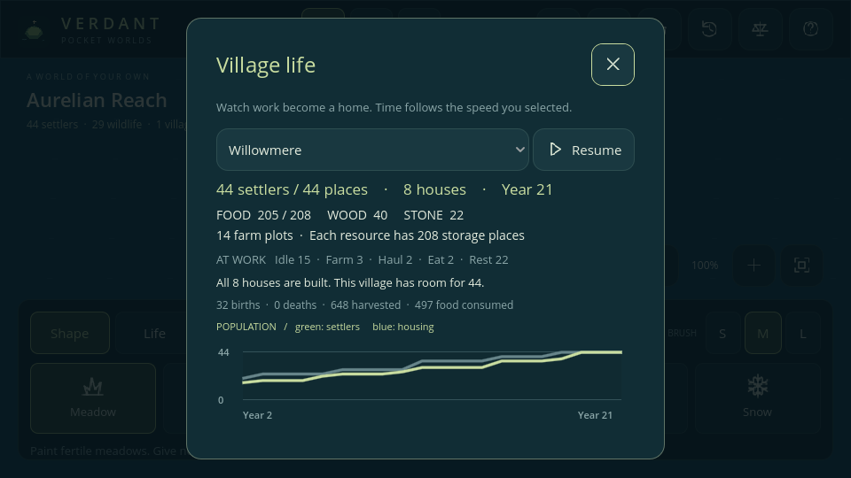
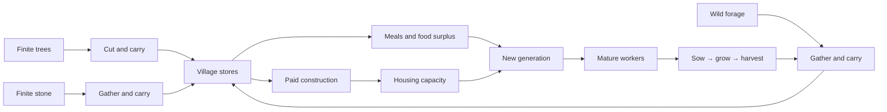

# Phase 2 — A self-sustaining village

Implemented in v0.2.0. Open **Observe → Villages**, or **World chronicle → Visit village dashboards**, to follow a settlement. The dashboard keeps the selected simulation speed and has its own Pause/Resume button. Inspect a worker to see their activity, cargo, and route.

## A physical economic loop

A resource must leave a tile, travel in a worker's inventory, and reach the village depot before it enters storage. Cutting a channel can prevent delivery. Goods carried when a creature dies are lost. Civilian goods still travel only over land; Phase 4 boats carry military companies and their rations.

The six Shape presets set elevation and biome together, but elevation, biome, tree stock, stone, forage, fire, crops, and farm ownership are independent model arrays. Biomes can be painted independently while preserving elevation and buildings. Harvesting trees leaves the underlying woodland in place. Painting replaces the cell's resources and removes any farm or building there; it is a creative power, so repainting can replenish resources.

## Rules and balancing values

| System | Current rule |
| --- | --- |
| Founding | Four nearby adult settlers on connected fertile land; one becomes the founder, neighbors join |
| Joining | Unsettled adults within 16 tiles can join a reachable village |
| Navigation | Four-neighbor A*; ocean and mountains block; no swimming, civilian boats, or diagonal corners |
| Resource reach | Gathering target within 24 tiles of home and within the worker's local search; actual route can detour |
| Work | Three work ticks to gather, sow, or harvest; up to six units carried |
| Trees | Up to 12 wood per cell; woodland without a farm/stone deposit regrows one wood per 192 ticks (four years) |
| Stone | Up to 24 per deposit; does not regenerate |
| Wild forage | 0–20 per fertile non-farm cell; +0.125 every eight ticks |
| Farm planning | One new plot every 12 ticks while below target; target ceil(population / 3), bounded to 3–14 |
| Farm location | Reachable bare fertile land within 10 tiles of the depot, at least three tiles from its center |
| Crops | Empty plot → worker sows stage 1 → grows to stage 64 → worker harvests six food → empty plot |
| Storage | Per resource: 80 + 16 per house; excess cargo waits for space |
| Housing | Camp shelters 12; each house adds four places; eight houses maximum (44 places) |
| House | 12 wood + 4 stone paid when work begins, then six work ticks at a reachable site |
| Construction | One active site per village; another worker can resume accumulated progress |
| Food | Pantry meal costs one food and removes 40 hunger; members return home to eat above 30 hunger |
| Emergency food | With an empty pantry, local forage can feed a villager; carried food can also be eaten |
| Births | Healthy, fed, mature partners within six tiles, in the same connected village; free housing and at least max(8, 2 × population) food |
| Birth cost | Two stored food; both parents wait 192 ticks before another child |
| Maturity / old age | Settler 16 / 85 years, rabbit 2 / 16, deer 3 / 32 |
| Children | Eat and stay near home; adult work begins at maturity |
| History | One sample per year, retaining 120 years; population and housing graph, food snapshot |

Job selection prioritizes eating and hauling, then farm work, low food stores, pending construction, housing demand, wood, and stone. Workers reserve targets to avoid duplicating a task. Idle adults wander near home and retry work after a short delay. Wildlife and nomads continue local forage movement. Full resource stores never stop workers from eating.

The village's `gathered_wood`, `gathered_stone`, and `harvested` counters record extraction/harvest, including goods still in transit. Current stores record only delivered inventory. `consumed` records pantry/carried meals and birth costs; direct wild forage is outside the village stock accounting.

## Intervention and failure

- Rain extinguishes fire, restores forage, and adds eight growth stages to planted crops.
- Fire destroys wood and crops while preserving the underlying biome, houses, and plot ownership; rain can extinguish it. Earthquakes and material edits clear buildings and plots. Burning routes can stall workers until the fire ends.
- Painting or meteors remove affected farms and houses. Population may exceed reduced housing after destruction; births stop until space returns.
- A depleted pantry emits a chronicle event at the yearly check. Recovery emits another event.
- Deleting the depot's land or losing every inhabitant abandons the village. Farms and buildings are cleared, historical records remain, and surviving members become nomads.
- Existing stored goods may exceed capacity after houses are destroyed. They remain usable; further deposits wait until there is room. A destroyed construction site loses its paid materials.

## Acceptance evidence

The automated agricultural-island comparison starts both worlds with 12 adults, 24 stored food, and six mature plots, with no wild forage. After 600 ticks the intact version sustains 12 settlers; the version with its plots destroyed falls to zero. This is a controlled scarcity scenario, not a promise that every farm fire kills a village with other food sources.

A separate resource-rich island runs for 4,800 ticks (100 years) with hunger, aging, and births enabled. It survives, replaces the founders, builds housing, harvests crops, and respects the housing limit. JSON save/load compares every persisted field over the next 120 ticks. See [testing](TESTING.md) for the latest recorded results.

## Scope boundaries

There are no professions/skill trees, trade, warehouses as separate buildings, roads, civilian shipping, irrigation, or seasons yet. The population budget stays at 350 until real Android profiling supports raising it. Phase 3 adds kingdom ownership and expansion over this model; see [politics](POLITICS.md). Expedition supplies leave local stores and existing adults travel to found new settlements. Phase 4 also draws workers and resources into [military companies and defense](WARFARE.md), with real economic casualties.

## Phase 5 integration

Settler craft traits change gathering and farm work to two ticks (industrious) or four (unhurried), with the same goods, travel, and costs; neutral remains three. House construction stays at six shared work stages. Hunger and matching habitat traits affect food demand. Births now record two parents and inherited traits while retaining food/housing/cooldown constraints. See [heredity](HEREDITY.md).

## Phase 6 integration

Weather, moisture, temperature, seasons, and ages affect actual crop/forage growth. Heat/cold modify food demand; disease can suppress recovery. Under drought, workers may have no mature crops to harvest. Rain restores growth. Independent biome painting preserves homes but removes farms on arid/tundra/barren land. The climate-enabled century scenario still survives; the focused conservation test disables climate modifiers to measure base work costs. See [environment](ENVIRONMENT.md).
