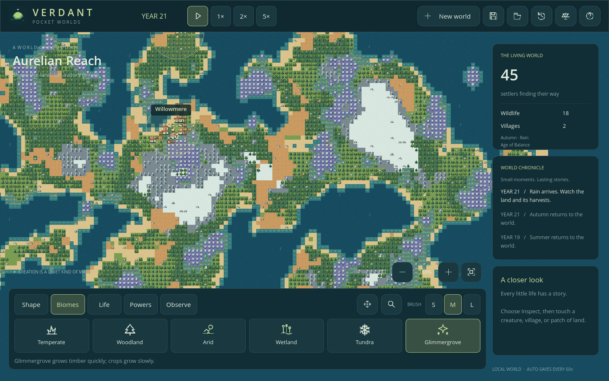
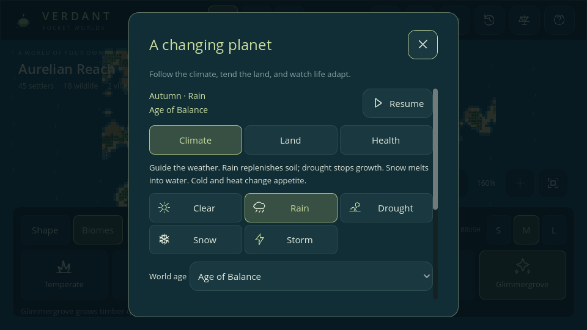

# Phase 6 — A changing planet

Implemented in **v0.6.0**. Biomes, climate, vegetation, illness, and disasters now affect the same people, farms, kingdoms, and families introduced in earlier phases.

## Observe and intervene

**Biomes** offers six independent ecosystem brushes. They preserve elevation, coasts, navigation, creatures, and houses. Painting an infertile biome removes incompatible farm plots. It does not create free timber or forage; growth takes time. The original **Shape** brushes remain convenient combined material/elevation/biome presets.

Inspect a tile, then open **Observe → Planet**. The live inspector remembers that cell and exposes three pages:

- **Climate:** current season, weather, world age, weather interventions, and law presets.
- **Land:** biome, elevation, temperature, moisture, snow, resources, and growth conditions.
- **Health:** infected/immune population, disease-law status, and active eruptions.

The panel follows the selected time speed and offers Pause/Resume. Its scrollable phone layout keeps weather controls at the top. **Lives** and ordinary creature inspection show illness/immunity timers; recovery becomes a personal memory.

## Independent ecosystems

Biome IDs 0–3 retain their earlier meanings for migration. Elevation still determines movement: ocean and peaks block land travel; lowlands are walkable. Biome brushes cannot paint ocean into land. Peaks can have a biome identity but do not grow plants.

| Biome | Base temperature | Forage cap | Main distinction |
| --- | --- | --- | --- |
| Temperate | 20°C | 20 | Balanced farms and sparse trees |
| Woodland | 16°C | 20 | Up to 12 wood per tile; one wood per 192 unstressed ticks |
| Arid | 32°C | 4 | Sparse forage, no trees or farms |
| Wetland | 22°C | 20 | Double temperate forage growth; renewing reeds; rare Rustfever exposure |
| Tundra | −4°C | 4 | Sparse forage and slow growth; no farms |
| Glimmergrove | 12°C | 16 | Original luminous woodland; one wood per 96 unstressed ticks; slower crops |

Barren soil remains biome 0 with no forage or timber growth. Trees and forage regenerate in staggered eighth-grid batches. Woodland, wetland, and glimmergrove regrow locally; existing trees can spread into adjacent suitable land. Occupied farm plots do not grow timber. Finite stone is unchanged. All stock quantities remain bounded.

Existing habitat genes still apply: meadow adaptation helps temperate and wetland creatures; woodland adaptation helps woodland and glimmergrove; cold adaptation helps tundra. Biomes change the usefulness of inherited traits, not the genome itself.

## Climate and growth

Climate has its own saved RNG and clocks. Normal game RNG remains responsible for work, movement, reproduction, and combat. The tables are game rules, not a physical climate model.

- **Weather:** clear, rain, drought, snow, or storm. Automatic forecasts last 96–192 ticks; an intervention lasts 144 ticks. Rain is more likely than storms. Winter favors snow; hot/frost ages bias forecasts.
- **Seasons:** spring, summer, autumn, winter, each lasting 96 ticks. Their temperature modifiers are 0, +8, −2, and −12°C. An ecological season spans two of the game's accelerated life-years.
- **Ages:** Balance, Embers, and Frost, each lasting 1,536 ticks, with modifiers 0, +12, and −12°C. The player may select an age in Planet.
- Weather temperature modifiers are 0, −3, +10, −14, and −5°C respectively. The final temperature combines biome, season, age, and weather.

Soil moisture is an integer from 0 to 100. Rain/storm replenish it, drought dries it rapidly, and clear weather dries most land gradually. Wetland and glimmergrove retain moisture. Weather visits each lowland cell once per eight ticks. Rain and snow extinguish encountered fire. Snow cover is bounded to eight levels and melts into moisture when temperatures rise above zero.

Growth stops during drought, below 16 moisture while weather is active, below −4°C, or above 40°C. Cool/hot conditions slow growth; glimmergrove also slows crop development. Rain adds 50% to forage regrowth and advances eligible crops two stages per tick instead of one. Inactive climate laws remove temperature/moisture stress; glimmergrove retains its slower crop rule. Turning **Plant growth** off freezes forage, tree regrowth/spread, and crop growth.

Cold below 0°C adds 25% to appetite unless a creature has cold adaptation. Heat above 32°C adds 12.5%. These exact binary fractions combine with inherited hunger modifiers. They create food pressure through ordinary foraging and pantry consumption. Climate never directly deletes a civilization.

Fire destroys vegetation and crops while preserving the underlying biome, elevation, structures, and plot ownership. Regrowth and resowing can follow. Drought and the Age of Embers increase the fire-spread chance. Destructive god powers can still clear farms and buildings.

## Rustfever

All three base species can contract Rustfever. Contact transmission requires the same species, distance at most two cells, and connected walkable terrain. Every eight ticks, an infectious creature gives each susceptible local contact a one-in-four exposure chance. Exposures are applied after scanning, preventing same-tick infection chains.

An infection lasts **64 ticks**. It prevents ordinary natural recovery and removes 0.25 health per tick, or 0.5 above 60 hunger. A healthy, fed creature can survive; starvation or other damage can make the infection fatal. Recovery grants **192 ticks** of immunity, preventing reinfection. Disease timers, immunity, and their continuation are saved.

Every 96 ticks, a creature on wetland has a one-in-128 exposure chance. **Powers → Plague** seeds susceptible creatures in the brush area. It respects immunity and the Disease law. **Blessing** restores health and hunger without erasing infection. Living infected creatures carry a small amber marker.

Turning Disease off pauses transmission, infection damage, recovery countdown, and immunity countdown. The UI explicitly marks this state. There is one disease model; hospitals, cures, multiple pathogens, and species-specific disease biology remain future extensions.

## Bounded disasters

| Power | Consequence |
| --- | --- |
| Lightning | Radius one, 35 damage, ignites fertile land |
| Earthquake | Radius three, 55 damage, turns affected lowland to barren sand and clears houses/farms |
| Volcano | Radius three, 55 initial damage, raises an impassable central peak, starts six ember pulses over 24 ticks |
| Plague | Seeds Rustfever among susceptible nearby creatures |

Volcanic embers choose nearby land and may ignite vegetation or deal 12 damage to nearby creatures. At most **eight** eruptions can be active; expired vents are removed. Eruptions survive save/load. Raised peaks use ordinary navigation invalidation, so workers and armies replan. Rain can put out ember fires. The volcano's finite pulses are consequences of an intervention and continue even if spontaneous disasters are disabled.

The **Natural disasters** law is off by default. When enabled, it advances a 192-tick scheduler with a one-in-four event chance; events choose lightning, earthquake, or volcano. Storms can also cause lightning every 24 ticks under this law. Turning the law off freezes spontaneous scheduling. Manual god powers remain available.

## Laws and presets

Six new laws supplement the six earlier laws: Weather, Seasons, World ages, Plant growth, Disease, and Natural disasters. Weather/season/age laws pause their own clocks and remove their modifiers while off; re-enabling resumes their saved clocks.

| Preset | Behavior |
| --- | --- |
| Living planet | Ecology and survival active; spontaneous disasters off |
| Peaceful | Hunger, old age, illness, fire spread, and spontaneous disasters off; climate and vegetation remain active |
| Catastrophe | Ecology, survival, illness, fire spread, and spontaneous disasters active |

Presets leave birth, expansion, and diplomacy preferences intact. They do not end declared wars, revive dead creatures, clear ongoing eruptions, or block manual powers. Fine-tune individual switches with the top-bar scales button.

## Saves, limits, and evidence

Schema **v6** saves independent biomes, moisture, snow, climate/RNG clocks, infection/immunity timers, six new laws, and finite eruptions. Validation rejects out-of-range states, water carrying land ecology, impossible illness/immunity combinations, malformed clocks, and oversized/duplicate hazards before replacing the world.

A genuine **v5** fixture was captured before changing the serializer: Frontier seed 41827, tick 960, 156 living creatures, 172 family records, three kingdoms, and one favorite. All genuine v1–v5 fixtures migrate. Existing terrain-linked biomes retain their IDs; climate starts clear with no snow or illness. New climate/disease/disaster laws start off for old saves, while existing plant growth remains on. IDs, stocks, family histories, favorites, and ordinary RNG state remain intact. Use Living planet to enable the new systems.

Automated scenarios cover independent painting, real growth and harvest differences, snow/melt, temperature adaptation, all law controls, disease transmission/barriers/recovery, actual disaster damage, 240-tick JSON continuation through changing weather/illness/eruption, legacy migration, corrupt files, and native phone touches. [Testing](TESTING.md) records results and limitations.

The world remains 144 × 96 with at most 350 living creatures and 2,048 lifetime records. Weather is global; soil, snow, and ecosystem conditions are per tile. No fluid flooding, atmospheric simulation, roaming disaster creatures, or physical-device performance claim is included. Production audio and native mobile packaging remain on the [roadmap](../ROADMAP.md).
