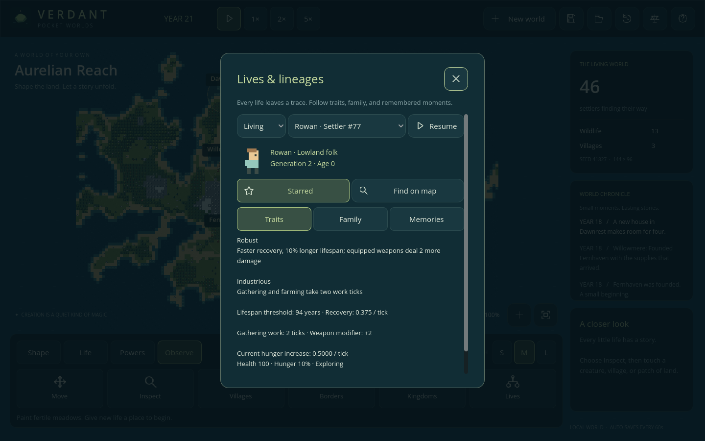
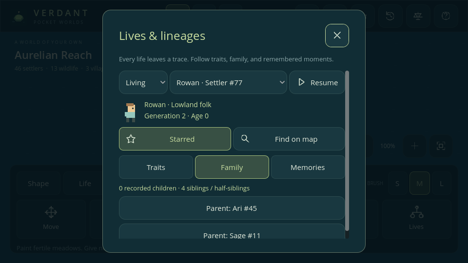

# Phase 5 — Lives and lineages

Implemented in **v0.5.0**. Creatures inherit small genomes, express traits, develop families, and leave memories after death. The same individuals still participate in the economy, politics, and wars.

## Follow a life

Choose **Inspect**, touch a creature, then open **Observe → Lives**. The inspector starts at that creature. Its selector can show living creatures, favorites, remembered lives, or the whole archive. People and wildlife both have records.

- **Traits** explains expressed traits, habitat adaptation, lifespan, recovery, and relevant work/combat effects.
- **Family** links to both parents and every recorded child, and counts siblings and half-siblings. Links remain usable after relatives die.
- **Memories** retains the latest six personal events: arrival/birth, children, new inherited variation, adulthood, trait changes, military service, rulership, or death.
- **Favorite** stars a life; up to 32 can be kept, including the deceased. A favorite's death also appears in the world chronicle.
- **Find on map** closes the panel and focuses a living creature. A remembered life has no map location.

The inspector follows the selected time speed and offers Pause/Resume. The phone layout uses native controls and a scrollable body. A gold ring identifies living favorites on the map.

## Species are project data

`data/species/settler.tres`, `rabbit.tres`, and `deer.tres` define maturity, lifespan, birth chance/cooldown, settlement behavior, sprite identity, and subspecies names. `SpeciesCatalog` supplies these definitions to spawning, reproduction, survival, adulthood, and validation. Existing species retain their base values:

| Species | Maturity | Base lifespan threshold | Birth chance per eligible tick | Cooldown |
| --- | --- | --- | --- | --- |
| Settler | 16 years | 85 years | 0.08 | 192 ticks |
| Rabbit | 2 years | 16 years | 0.018 | 120 ticks |
| Deer | 3 years | 32 years | 0.018 | 120 ticks |

These are simulation rules, not a claim of biological realism. Age advances at calendar-year boundaries. Old-age damage begins after the lifespan threshold; it is not a guaranteed death date. Resource files are trusted project assets; save files store known species IDs, never executable resources.

## Inheritance and mutation

Each creature has two copies of five genes: **metabolism, vigor, craft, habitat, and coat**. Parents contribute one randomly selected copy at each gene. The world-owned RNG controls inheritance, preserving repeatable continuation through save/load.

Metabolism, vigor, and craft copies range from -1 to +1. The sign of their sum determines the expressed trait; opposite copies balance to neutral. Habitat copies range from 0 to 3 and require two identical nonzero copies to express an adaptation. Coat copies range from 0 to 3; their summed value modulo four selects an original sprite variant. Appearance has no statistical bonus.

Each inherited copy has a **1-in-32 mutation chance**. A mutation selects another valid allele. Habitat mutations favor the birth tile's grassland, woodland, or tundra biome when that differs from the inherited copy. A personal variation event is recorded when the child has an allele absent from both parents. A mutation matching an allele already present in the other parent still counts genetically, but does not receive that novelty event.

Introduced founders get deterministic variation from seed and ID using a separate RNG. This does not change the world's terrain-generation random sequence. Half of founders receive matching habitat copies from the land where they were placed. Existing creatures do not rewrite their genes when terrain changes; the terrain changes whether their adaptation currently helps.

Autonomous reproduction still requires eligible adults, the same species, compatible village membership for settlers, nearby reachable partners, health, food, cooldown, and spare housing. It now records both actual parents. Self-pairing, parent/child pairing, and pairing between siblings or half-siblings are excluded. Different habitat variants of one species can interbreed. Cousins and more distant relatives are not excluded in this prototype.

## Traits with effects

| Gene | Expressed trait | Effect |
| --- | --- | --- |
| Metabolism - | Thrifty | Hunger rises 12.5% slower |
| Metabolism + | Hungry | Hunger rises 12.5% faster |
| Vigor - | Frail | Recovery 0.125 health/tick; lifespan threshold 10% shorter, rounded; equipped weapons deal two less damage |
| Vigor + | Robust | Recovery 0.375 health/tick; lifespan threshold 10% longer, rounded; equipped weapons deal two more damage |
| Craft - | Unhurried | Settler gathering/farming needs four work ticks |
| Craft + | Industrious | Settler gathering/farming needs two work ticks |
| Habitat 1 | Meadow adapted | Hunger rises 12.5% slower on grassland |
| Habitat 2 | Woodland adapted | Hunger rises 12.5% slower in woodland |
| Habitat 3 | Cold adapted | Hunger rises 12.5% slower on tundra/snow |

Neutral recovery remains 0.25 health/tick, gathering takes three work ticks, and hunger increases by 0.5/tick. Habitat and metabolism multipliers combine. Recovery still requires low hunger; the hunger and old-age laws retain their effects. Food is still consumed physically, cargo quantities do not increase, and house construction costs/progress are unchanged. Weapon modifiers affect soldier attacks; towers keep their base damage. Final weapon damage is bounded to 1–25.

Craft is latent in wildlife genomes and is not presented as an active work trait for animals. Vigor affects wildlife recovery and lifespan even though wildlife do not wield weapons. Rates use exact binary fractions so JSON round trips preserve future behavior exactly.

Habitat expression determines a named subspecies: Meadowfolk/Woodland folk/Frostfolk, Clover/Moss/Frost rabbits, and Meadow/Woodland/Tundra deer. These are derived variants within the same base species, with the hunger advantage above. They are not independent species records or arbitrary labels with no effect.

## Family memory and limits

Records use the existing stable entity IDs. Every birth appends one record with parent IDs, a derived generation, genome, birth tick, origin, favorite flag, and bounded memories. Death archives the final age/tick and removes only the live entity. Parent IDs therefore continue to resolve after a ruler, worker, soldier, or animal dies. Introduced adults' birth ticks are estimated from their arrival age; ancestry before arrival is explicitly unknown.

The world retains **2,048 lifetime records**, **350 living creatures**, **32 favorites**, and **six memories per life**. Reaching the history limit stops new births and introductions; it never silently deletes ancestors or leaves dangling links. This is a deliberate prototype budget, visible when adding new life. A larger archive needs storage and device profiling. Favorites do not freeze aging or protect against disasters.

Traits and effective statistics are derived from the genome. The model's atomic `Heredity.replace_traits` operation rejects unknown, duplicate, and mutually exclusive traits before changing anything. It updates both the live creature and its historical identity. The playable UI is inspection-focused; a player trait/genome editor, chromosome puzzles, possession, and expanded genealogy visualization remain future work.

## Saves and verification

Schema **v5** saves living genomes and the historical archive. The derived lookup table, portraits, selection, and panels are not serialized. The loader validates gene names, allele bounds, matching live/archive genomes, stable IDs, chronological acyclic parent links, species/generation consistency, favorite limits, and event bounds before replacing a world. The file limit is eight MB.

A genuine Phase 4 fixture was captured before changing the serializer: Frontier seed 41827 at tick 1,262, with 213 creatures and five military company records. Migration from genuine v1/v2/v3/v4 saves preserves lives, IDs, time, stocks, political/military state, and RNG. Living creatures receive neutral genes and explicitly unknown earlier ancestry; migration fabricates no deceased ancestors or prior personal history. Earlier files remain untouched until saved.

Tests cover deterministic founders, inheritance/mutation, real hunger/recovery/work/combat effects, incompatible edits, parents/children/grandchildren, archived grandparents, favorites, memory/history caps, actual JSON continuation, all four legacy schemas, malformed saves, native phone touch navigation, and disk reload. See [verification](TESTING.md) and the [roadmap](../ROADMAP.md).

## Phase 6 integration

Current saves use v6. Wetland maps to meadow adaptation and glimmergrove to woodland adaptation without adding alleles. Cold adaptation also avoids the cold appetite penalty. Lives shows Rustfever/immunity timers and illness/recovery memories; inherited genetics and past ancestors are preserved. See [environment](ENVIRONMENT.md).
