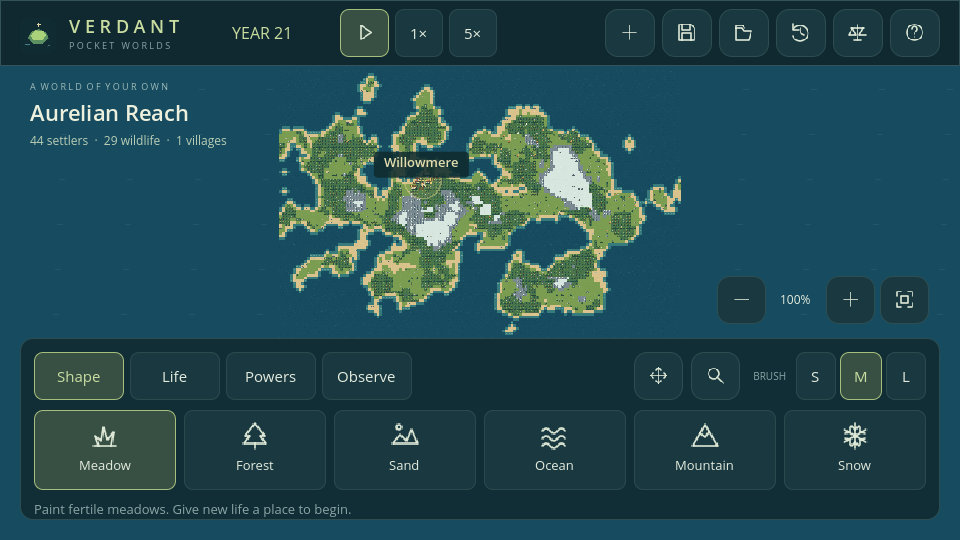

# Mobile development and export

Phase 8 is a **Godot editor source delivery**. Download and test it using [the Godot testing guide](GODOT_TESTING.md). APK/AAB builds are deferred at the user’s request; the export instructions below are for a later device-testing phase.

## Current support

The game targets landscape Android/iOS using Godot's **Compatibility** renderer and GDScript. It has no native extensions and needs no network permissions. Desktop development uses the same scene/model. `project.godot` locks landscape orientation and enables mouse-from-touch emulation for native Godot buttons. The world canvas filters emulated mouse events and handles raw touch itself, preventing duplicate painting.

Mobile builds select a 960 × 540 logical canvas with adaptive wide-screen expansion. The HUD uses compact controls and hides the large sidebar. Display safe-area offsets are applied to the header/dock. Button sizes and actual thumb reach still require device checks; a synthetic viewport is not proof of usability on every phone.



## Android debug build

The repository includes an **Android** export preset with package ID `org.verdant.pocketworlds`, arm64, version `0.8.0` / code `8`, and Internet permission disabled. Choose a final package identifier before distribution.

1. Install Godot **4.6.3 standard** and its matching **4.6.3 export templates** through Editor → Manage Export Templates. Keep engine/template versions identical.
2. Install **OpenJDK 17** and the Android SDK tools required by the [Godot 4.6 Android export guide](https://docs.godotengine.org/en/4.6/tutorials/export/exporting_for_android.html). Install the SDK platform/build-tools versions listed there; accept the Android SDK licenses locally.
3. Set **Editor Settings → Export → Android → Java SDK Path / Android SDK Path** to your installed directories. Do not commit machine-specific paths or signing credentials.
4. In Project → Export, select **Android** and resolve every validation message. Debug builds can use a local debug keystore. Release signing requires your own keystore kept outside the repository.
5. Create `build/android/`, export a debug APK, and install it on an arm64 device with USB debugging enabled.

```sh
mkdir -p build/android
./tools/godot.sh --headless --export-debug Android build/android/verdant.apk
adb install -r build/android/verdant.apk
```

These commands require the SDK, Java paths, debug signing configuration, and matching templates above. The checked-in project does **not** contain a keystore or an APK. `export_credentials.cfg` and generated builds are ignored.

The current preset uses the standard template export path; there is no custom Gradle plugin. Use a custom Gradle build only when a feature actually needs it. Generate an AAB with release signing for Play distribution after device QA and store setup.

## iOS

An iOS archive requires **macOS, Xcode, matching Godot export templates, an Apple development team, and signing/provisioning**. On that machine:

1. Import the project into Godot 4.6.3.
2. Add an iOS export preset. Set your team ID, unique bundle identifier, app icons, and version. Retain the landscape orientations.
3. Export an Xcode project into the ignored `build/ios/` directory.
4. Open it in Xcode, select the team/device, resolve signing, and run on hardware.
5. Test lifecycle and safe areas before archiving for TestFlight.

Refer to the [Godot 4.6 iOS export guide](https://docs.godotengine.org/en/4.6/tutorials/export/exporting_for_ios.html). Team IDs and signing identities are intentionally not invented in this repository. This Linux environment has not produced or tested an iOS archive.

## Device acceptance checklist

- [ ] Cold launch on low/mid/high Android and representative iPhones/iPads.
- [ ] Readable text, accessible tool labels, 48 dp target sizes, and thumb reach at device UI scale.
- [ ] Notches, gesture bars, landscape rotation, and 16:9 / 19.5:9 / tablet layouts.
- [ ] Tool taps do not leak through menus into the world.
- [ ] One-finger painting, two-finger pan/pinch, finger release outside UI, and rapid gesture changes.
- [ ] Paint while zoomed and near map edges; zoom around the gesture center.
- [ ] Pause/speed changes and long frames do not produce runaway catch-up simulation.
- [ ] Suspend/resume during simulation and in each dialog; Android back closes a panel safely.
- [ ] Restore autosave after OS termination; save/load after terrain edits and new-world creation.
- [ ] Low-storage failure shows an error without deleting the previous saved slot.
- [ ] Political overlay, realm/partner selectors, Realm/Diplomacy/War/Chronicle tabs, powers, and live refresh.
- [ ] Declare war/peace, army recruitment/orders, watchtowers, follow-company camera, and transport inspection.
- [ ] Save/resume during battle, retreat, capture, boarding, sailing, and edited water routes.
- [ ] Lives filters, Traits/Family/Memories tabs, favorite toggling, deceased relatives, and ancestor/child navigation.
- [ ] Family archive scrolling near 2,048 records and save/load during births/deaths.
- [ ] Village dashboard scrolling, Pause/Resume, settlement selector, and population graph.
- [ ] Routing and terrain-edit frame times with working villages at the 350-creature cap.
- [ ] 30-minute thermal/battery/memory test with 350 creatures and active fires.
- [ ] Frame-time capture in exported release/debug builds; compare with editor behavior.

The automated tests verify gesture logic and a 960 × 540 layout. They do not establish hardware GPU speed, thermal behavior, OS permission/signing correctness, or interruption-safe storage on actual devices.

## Desktop fallback

Open the project in Godot for immediate play. The **Linux** preset can export a native Linux build after installing matching Linux export templates. Desktop executables are not required to develop the mobile game. Use the same save format and regression scenarios across platforms.

Phase 6 device checks: scroll Climate/Land/Health, change forecasts and law presets, paint biomes along a coast, inspect disease timers, and suspend/reload during an eruption. Rain/snow canvas effects and terrain chunk uploads need hardware profiling before larger-world budgets.

Phase 7 device checks: open Society from the eight-item Observe palette; scroll all four pages, select remembered members and rulers, follow links to Lives and back, filter long history, and switch graph measures. Suspend/reload during adoption and after a knowledge unlock. The native phone tests use a 960 × 540 Godot window; real safe-area, touch-driver, memory, and thermal checks remain outstanding.

Phase 8 device checks: test all six named slots, previous-version recovery, quick save after creating a new world, and low-storage failures. Verify volume/mute across suspend/resume and interruptions, larger text with the system keyboard, contrast, reduced motion, 30/60 frame caps, and focus behavior. Measure four-chunk uploads during large edits on hardware. The Linux automated recovery checks do not replace native storage interruption or thermal testing.
