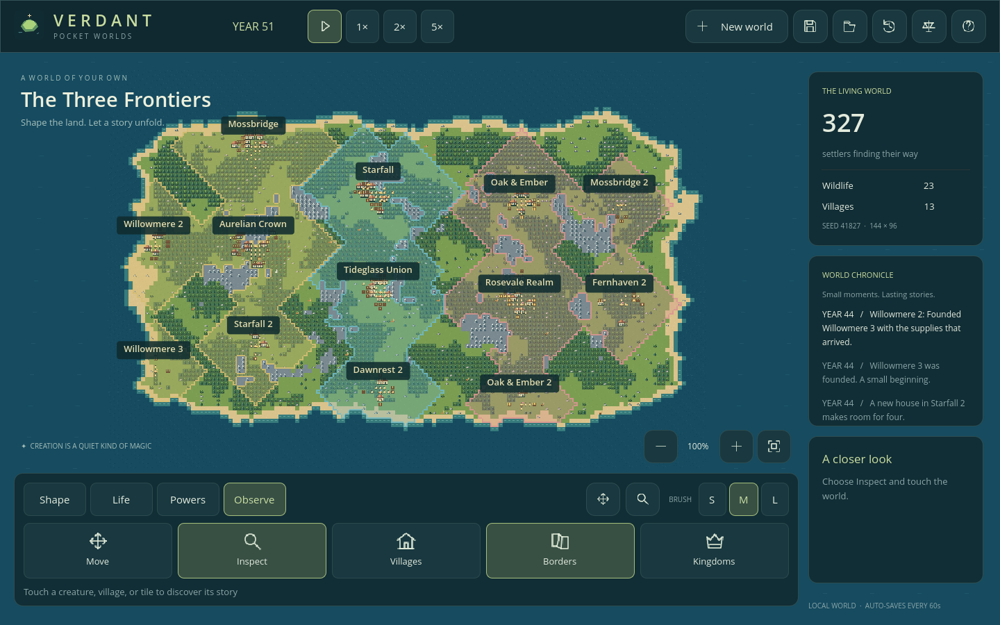
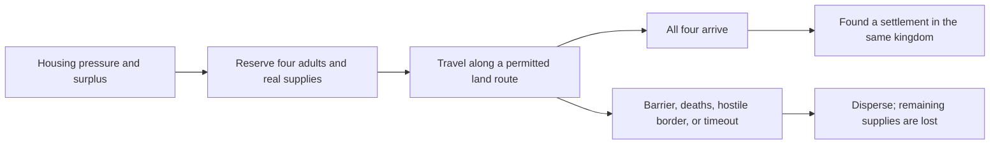

# Phase 3 — Crowns and frontiers

Implemented in **v0.3.0**. Choose **New world → Frontier continent · three peoples** for three separated settler groups on connected land. They found villages, develop their economies, form kingdoms, and eventually send expeditions. The seeded Frontier acceptance scenario reaches natural border contact within 25 simulated years. The original continent and archipelago presets remain available.

Open **Observe → Borders** to show claims. With borders visible, **Inspect** on claimed land opens its owner. **Observe → Kingdoms** opens the live inspector directly. Its **Realm**, **Diplomacy**, **War**, and **Chronicle** tabs show settlements/loyalty, relations/interventions, companies/defense, and political history. Time follows the selected speed and can be paused inside the inspector.

## Ownership and rulers

Each independently founded village starts a kingdom. A kingdom can have several settlements; colonies retain the parent kingdom. Stable kingdom IDs are never reused. Village membership determines a settler's allegiance, so there is no second membership field that can disagree with the village.

A realm selects its oldest living adult settler as ruler; equal ages favor the lower entity ID. The ruler remains in office until death or loss of membership. A realm containing only children awaits an adult ruler. Succession, founding, independence, capital transfer, and collapse enter the realm chronicle and world events.

When a capital is destroyed, the first surviving settlement becomes the new seat. Losing the last settlement ends the realm. Historical records remain; fallen kingdoms own no cells and have no ruler or capital.

Claims spread along four-neighbor walkable land for **12 + houses** steps from each settlement. Water and mountains block them. The nearest settlement wins overlap; equal distances favor the older village ID. Terrain changes and settlement changes rebuild ownership. Color shows current claims; unclaimed land is still available for settlement. Six heraldic colors repeat if many kingdoms emerge; names and inspectors identify the exact owner.

## Expansion is a journey

An expedition uses existing people. It does not add creatures to the population or create a village remotely.

| Requirement | Current rule |
| --- | --- |
| Housing pressure | At least 20 residents, with population at least housing capacity minus four |
| Food reserve | At least max(48, 2 × population + 24) stored food |
| Supplies | Deduct 24 food, 12 wood, and four stone from the origin |
| Adults | At least eight available, healthy, fed adults; send four, excluding the ruler and anyone carrying cargo |
| Initial wait | New/migrated villages wait five years before considering expansion |
| Retry / cooldown | Retry a failed search after two years; after departure wait ten years |
| Site | Reachable fertile land within 40 Manhattan tiles; at least 24 Euclidean tiles from all living villages and reserved expedition sites |
| Farmland | At least 18 of the 25 cells around the destination must be fertile |
| Ownership | Destination must be unclaimed or in the same kingdom |
| Travel | Shared A* routes, one adjacent tile per tick; rival territory forbids expedition transit |
| Arrival | All four living settlers must physically reach the destination |
| Supplies at arrival | Unused rations and materials become the new village's stores |
| Failure | A lost member/origin, blocked or invalid destination, closed rival border, origin's independence, or a journey exceeding eight years disperses the expedition |

Travellers consume expedition rations and remain counted in their origin until arrival. They do not reproduce while assigned. Colony founding transfers the same four IDs to the new village, freeing space in the origin. An abandoned expedition does not refund goods across impassable terrain; its remaining supplies are lost and the reason is recorded. Survivors remain where they are and resume local life.

Path requests share the existing 16-per-tick budget with workers. The planner conservatively rejects its chosen path if it crosses rival territory; it does not search a separate diplomatic detour grid. Active fire can stall a journey until it burns out.

## Relations with consequences

Contact is established by adjacent claimed cells from different kingdoms. Each pair has **one symmetric relation**, a bounded score, a posture, and the latest explanation.

| Score | Posture | Effect |
| --- | --- | --- |
| 50 to 100 | Alliance | Adds two loyalty per year to allied villages |
| -39 to 49 | Peace | Allows expedition transit through the realm |
| -100 to -40 | Rivalry | Blocks expedition transit through the realm |

At a shared border, the yearly score change is `2 + outlook A + outlook B`, minus eight if either realm has a settlement with a food shortage. Outlook is a stable realm disposition: open (+2), measured (0), or cautious (-2), assigned deterministically when a realm forms. Explanations distinguish prosperity, caution, and scarcity. Historical relations remain when contact is lost; automatic changes require current contact. Fallen partners no longer supply alliance benefits.

Rivalry is a political posture. Phase 4 adds a separate explicit war flag: annual score changes pause during war, and expedition transit is forbidden. Armies, capture, and transport are described in [warfare](WARFARE.md).

## Loyalty and independence

Villages start at 75 loyalty, bounded to 0–100. Every year automatic politics adds a base one, then:

- **+2** when food stores hold at least twice the population; **-8** when below max(2, population / 2).
- **-10** if an outlying village has no land connection to the capital; otherwise **-4** when more than 40 tiles away.
- **-2** when the kingdom lacks an adult ruler.
- **+2** with at least one living ally; multiple allies do not stack this bonus.
- **+8** while divine favor is active.

An outlying settlement at 20 loyalty or lower declares independence, becoming a new kingdom with its own capital and ruler selection. The former ruler loses that settlement's claims. The new pair begins at -55 rivalry, and an outgoing expedition from the seceding village disperses immediately. Capitals cannot secede from themselves.

## Divine interventions and laws

In the inspector's **Diplomacy** tab:

- **Bestow favor:** immediately adds 12 loyalty to the selected realm's villages and grants five years of yearly loyalty support.
- **Encourage peace:** adds 45 to the relation with the named partner.
- **Sow discord:** subtracts 45 from that relation.
- **Declare war:** sets a separate war state, allowing paid village recruitment.
- **Make peace:** during war, ends hostilities and recalls companies, as well as adding 45 to the relation.

The partner picker excludes the selected and fallen kingdoms. These are free sandbox interventions. Favor strengthens loyalty without creating food, wood, or people.

**World laws → New settlements** stops new departures; journeys already underway continue. **Politics** freezes automatic diplomacy and loyalty changes. Succession, territorial validity, existing travel, and direct player interventions still function so disabling automatic politics cannot leave dangling owners or rulers.

## Persistence and limits

Save schema **v3** stores kingdoms, pair relations, expedition supplies/members, village loyalty/retry clocks, unit expedition assignments, and both new laws. Territory and contact caches rebuild deterministically from settlement and terrain state.

Genuine v1 and v2 fixtures are tested. Migration preserves existing lives, IDs, resources, time, and RNG state, initializes realms around living villages without consuming RNG, and adds empty expedition state. The prior save file is not overwritten merely by loading it. Pending expeditions survive a JSON round trip with every persisted field matching after the next 120 ticks.

The world remains 144 × 96 with a 350-creature cap. Political history retains 32 events per realm, and the world retains 60. Records are bounded at 128 total kingdoms, 256 total expeditions, and 1,000 total villages, including historical entries; identifiers are never recycled. Reaching a record limit stops further creation of that record type. Larger budgets need profiling and an explicit archival design.

Trade, roads, and dynasties remain future work. Phase 4 adds armies, battle simulation, and transport boats; current saves use v4, migrating the v3 political state described above. Real Android/iOS performance and lifecycle verification remain outstanding.
