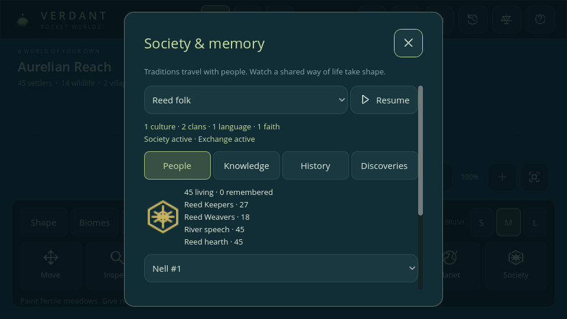

# Society and memory — Phase 7

Verdant v0.7.0 gives settlers learned identities, shared knowledge, and a record of social change. Open **Observe → Society**. Its four pages remain live and include a Pause/Resume control.

## Four independent identities

| Identity | Creation and continuity | Actual rule |
| --- | --- | --- |
| Culture | A founding village starts a tradition if no member brings one. Travelers retain it. | Its crop rotation and masonry knowledge changes work times. |
| Clan | Introduced founders join one of two social houses. Children learn their household's membership. | At least two living, off-duty members of one clan in a village add **+1 yearly loyalty**. |
| Language | Cultures initially use River or Hill speech; individual language can change separately. | Neighbor teaching supplies up to **4** knowledge progress per year with a shared majority language, otherwise **1**. |
| Hearth faith | Each founding culture begins a named communal tradition. Individual belief can change separately. | At least two local followers of the same faith provide **+0.125 natural recovery per tick** while ordinary recovery is allowed. |

Culture, clan, language, and faith have separate saved tables and IDs. None changes a genome, determines a species, or automatically assigns a kingdom. Clan means social household; it does not assert a biological relationship. All faiths currently share the same communal-care rule, and all cultures can learn both technologies.

Newborn settlers learn all four memberships from the eligible parent with the lower recorded ID. Genetic inheritance still uses both parents. Introduced settlers remain unaffiliated until joining a village; wildlife stays unaffiliated. Lives displays these memberships and links back to Society. Death retains the last affiliations with the family record.

## Knowledge from work

| Knowledge | Progress | Effect after learning |
| --- | --- | --- |
| Crop rotation | 96 actual food harvested from crops, or teaching from neighbors | Farm work needs one fewer tick than inherited craft timing, minimum one. |
| Masonry | Four actual completed houses, or teaching from neighbors | House work needs four ticks instead of six. |

The worker's culture receives progress only after completing the relevant work. Painting food, placing people, starting an unfinished house, or simply waiting awards no work progress. Sowing alone does not count as a harvest. Progress caps at each threshold, and each unlock is announced once.

Cargo remains capped at six. A house still consumes twelve wood and four stone before work begins. Knowledge changes work time; it creates no additional supplies and does not increase housing/storage caps. Disabling Society restores ordinary work times without forgetting learned progress.

Each year, villages within 32 tiles on connected land can teach one another if both have a strict majority culture and their kingdoms are not at war. Language is measured independently from culture. Each teacher shares only progress it knew at the start of that year, preventing an instantaneous relay through a chain of villages. Multiple qualifying neighbors can teach; progress stays capped. Canals and war block this exchange.

## Migration and gradual adoption

Existing colony expeditions move real people using paid supplies. They carry all four affiliations into the new settlement; no additional population or new culture is created just because a colony arrives. Military service and political capture also leave social identity independent from ownership.

A settled, off-duty person within 16 tiles of their home on connected land accrues residence one tick at a time. At the yearly social update, a strict local majority can teach:

- Culture after at least 96 residence ticks (two years).
- Hearth faith after at least 144 ticks (three years).
- Language after at least 192 ticks (four years).

The next annual update applies the change, so adoption can happen up to 47 ticks after a threshold. Ties cause no adoption. The yearly majority is captured before anyone changes membership. Clan and ancestry persist. Leaving the local community, joining active duty, or moving to another home resets residence; disabling exchange freezes the timer. Adoption updates both the live creature and its archive and records a personal memory.

## Laws

**Society** enables knowledge accumulation, learned work times, clan loyalty, communal recovery, and discovery evaluation. **Cultural exchange** additionally enables neighbor teaching, residence clocks, and gradual adoption. Society must be on for exchange to run. Both start on in new worlds.

Pausing rules preserves identities and earned learning. Founding/archival bookkeeping, actual ruler transitions, and annual population/resource samples still record the world. Political loyalty also requires the Politics law; ordinary recovery still respects hunger, illness, and the health cap. Existing environmental presets leave the two social laws as chosen by the player.

## Inspection and discoveries

- **People:** choose a culture, see its living and remembered membership, clan/language/faith counts, and open a selected person's family browser. The woven emblem uses the culture's stable color.
- **Knowledge:** read both thresholds and effects; switch the world graph between settler population, stored food, wood, and stone. Resource totals include living villages, exclude cargo, and use separate labeled vertical scales.
- **History:** filter social events by kind, selected culture, and all/last 10/last 50 years. The Rulers view filters by kingdom and links actual ruler IDs to their family records, including the dead. Vacant thrones and collapse remain visible.
- **Discoveries:** earn four saved journal emblems from observed conditions: two living cultures, crop rotation, a mixed-culture home, and a living settler with two recorded ancestral generations. These are optional experiments with no currency or stat rewards.

The original short world chronicle remains available. Society holds a longer social history and ruler timeline; neither claims to be an unlimited complete archive.

## Persistence and limits

Schema **v7** validates independent memberships, live/archive agreement, bounded work progress, continuous residence, laws, history references/order, discoveries, and graph samples before creating a replacement world. It normalizes JSON numeric IDs and consumes no new random stream. Social effects use exact binary fractions so save/reload can continue identically.

All genuine **v1–v6** fixtures migrate. Living village members gain current social affiliations with zero learned progress; historical dead remain unaffiliated because their earlier membership was not recorded. Existing genomes, parents, favorites, memories, resources, climate, disease, hazards, IDs, clocks, and random states remain intact. Current rulers receive a transition marked **Observed**, never an invented earlier reign. Both new laws start **off** in older worlds; enable them in Laws to begin social effects.

| Budget | Maximum retained |
| --- | --- |
| Living creatures / lifetime family records | 350 / 2,048 |
| Cultures / clans / languages / faiths | 128 / 256 / 2 / 128 |
| Social events / ruler transitions | 192 / 256, latest first |
| World graph samples | 120 years |
| Discovery objectives | 4 |

IDs never recycle. At the social registry cap, existing memberships and societies continue; new unaffiliated founders cannot allocate additional traditions. Advanced editors, a larger language/faith roster, civilian trade and transport networks, and larger histories remain future work. This phase adds no claim of mobile hardware performance; see [verification](TESTING.md) and [mobile acceptance](MOBILE.md).
