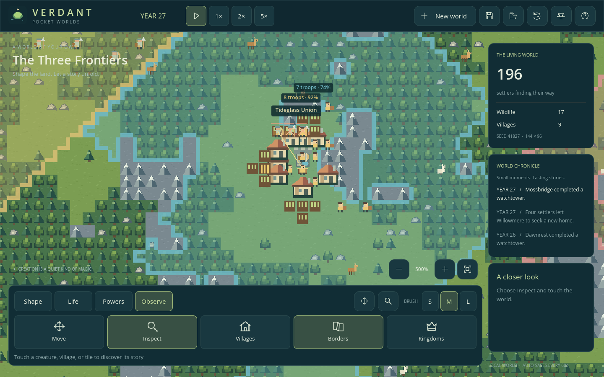
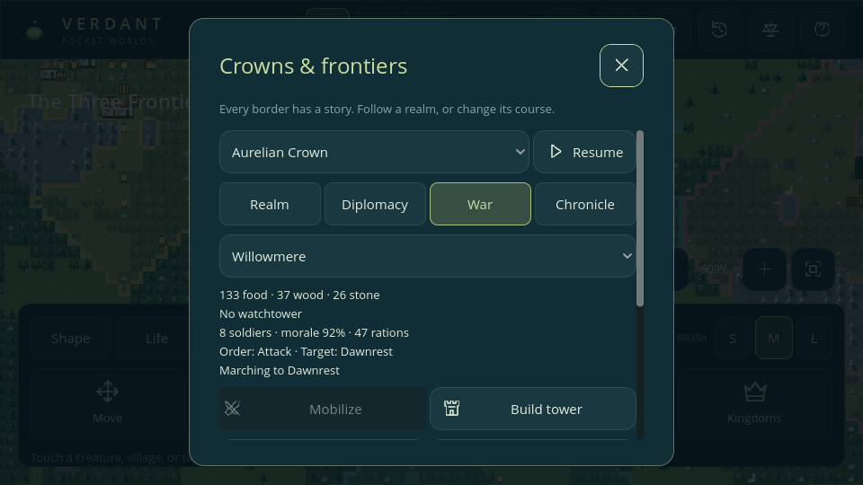
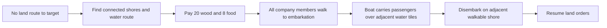

# Phase 4 — War and defense

Implemented in **v0.4.0**. Existing villagers become soldiers, take supplies from their home village, travel, fight, and return. War changes the same population, economy, and ownership that developed in earlier phases.

## Play a war

1. Create a **Frontier continent** and let its villages develop. Each soldier needs equipment and food from stores.
2. Open **Observe → Kingdoms → Diplomacy**, choose another living realm, and press **Declare war**. Rivalry by itself never starts a war.
3. Open **War**, select a settlement, and watch its company. Villages automatically try to recruit every six seconds at normal speed. **Mobilize** requests recruitment immediately.
4. **Defend home**, **Advance**, and **Return home** change the company's orders. **Follow company on map** closes the panel, zooms to a soldier, and shows its equipment, morale, and rations.
5. **Make peace** in Diplomacy immediately stops attacks between the selected pair and orders relevant companies home. A boat already sailing completes a safe crossing before returning.

Time keeps running inside the inspector unless paused. Each company banner shows surviving soldiers and morale; a return arrow marks retreat. Soldiers carry realm colors. Bows, spear strikes, watchtowers, transports, health bars, and capture progress draw on the map.

## Recruitment and supplies

| Rule | Value |
| --- | --- |
| Company | Four to eight existing adult settlers; one active company per origin |
| Workers retained | At most half the living village population is recruited |
| Eligibility | Age 16+, health above 65, hunger below 50, no cargo, no expedition or other company, connected to home; exclude the ruler |
| Equipment and starting rations | Per soldier: two wood, one stone, two food |
| Weapons | Every third recruit carries a wooden bow; others use stone spears |
| Rations | Shared company supply, maximum 48; refill from actual stores within one tile of home |
| Eating | At hunger above 30, consume one ration and reduce hunger by 40 |
| Automatic recruitment | Check every 24 ticks; a successfully mustered village waits 240 ticks before another company |
| Movement | One adjacent walkable land tile per tick, using the shared 16-request A* budget |

Soldiers remain residents of their origin. They stop ordinary work and reproduction while assigned. Casualties reduce actual village population and increment death counters. Healthy survivors return to civilian jobs; equipment is retired without material refunds. Remaining rations are deposited only when the company reaches home. A company cut off on land eventually disperses in place; it cannot deliver supplies remotely.

The first attack target is the closest living enemy settlement. A village targeted by an active invading company raises defenders when it can afford them. Defenders engage nearby enemy soldiers and otherwise hold home. The player can order them to advance. Recruitment can fail because available adults are carrying goods, stocks are insufficient, or the record cap is reached.

## Combat, morale, and capture

| System | Rule |
| --- | --- |
| Spear | 17 damage, Manhattan range one, four-tick cooldown |
| Bow | 11 damage, Manhattan range four, six-tick cooldown |
| Targeting | Nearby living enemy soldiers; actual declared war required; civilians and wildlife are not combat targets |
| Line of sight | Land-only supercover checks; water, peaks, and blocked corners obstruct fire |
| Morale | Starts at 100; -1 per incoming hit, -18 per lost member, -2 per tick for each soldier below 25 health or above 80 hunger |
| Retreat | At 30 morale or lower; attackers also retreat after 192 ticks without movement or fighting |
| Capture | A soldier within one tile, no enemy soldiers within five, no remaining tower; hold for 24 consecutive ticks |

Normal health recovery, starvation, fire, aging, and divine powers still apply. Combat runs entirely in the model; it requires no rendered creature nodes. Health damage is resolved in stable unit order. Morale is shared by the company; Phase 5 vigor traits now modify a soldier's weapon damage by ±2 and affect recovery/lifespan; base values in this table apply to neutral vigor. Combat skill remains future work.

Capture transfers the village's residents, houses, farms, and stores intact to the winner, sets loyalty to 45, stops outgoing colony expeditions, and demobilizes the local defending company. A captured company's passengers finish landing before demobilizing. Claims, rulers, capitals, and ownership reconcile immediately. The attacking company returns home after capture. A realm losing its last settlement collapses and its wars end; capturing one of several settlements does not force peace throughout the realm.

## Watchtowers

**Build tower** spends 16 wood and 12 stone once. Construction begins at one of 16 work stages and advances when an adult civilian is within two tiles of the depot. A completed tower has 160 health. It fires at one enemy soldier within five tiles every six ticks for nine damage. Attackers within one tile inflict 12 siege damage every four ticks.

A tower blocks capture while it survives. Fire removes 20 tower health per tick and cancels unfinished construction; abandonment removes the tower. Towers occupy the depot's footprint. There is no remote free construction or automatic repair; a destroyed tower can be funded again.

## Transport is a journey

A company needing a sea crossing searches coasts within 32 tiles of its current group and destination. A multi-source water search chooses a crossing of at most 512 water tiles. At most two companies attempt transport planning per tick, and each company attempts at most once that tick. A mountain barrier cannot be crossed by inventing a ship.

A transport costs 20 wood and eight food from the origin. It carries the whole company, with at most eight seats; the food becomes company rations up to capacity. Soldiers must gather at the embarkation shore. The boat then moves one adjacent water tile every two ticks, with passengers sharing its position. Passengers still need food and can be harmed by powers, but do not take land-creature drowning damage. The same paid transport can be reused for the return crossing.

Terrain edits invalidate the water route. The boat searches a new water path to its landing shore; if none exists it remains stranded until terrain makes a route or an adjacent landing possible. It never jumps across a barrier. A newly created walkable tile under the boat is also a safe landing. Peace does not unload passengers into the water.

This is company transport, not naval warfare or civilian trade. There are no autonomous freighters, sea battles, swimming, ports, or boat ownership independent of a company yet.

## Saves, verification, and limits

The Phase 4 schema **v4** stores war flags, reciprocal army membership, weapons/cooldowns, company orders/morale/rations/capture, tower construction/health, recruitment clocks, and boat positions/routes. The original Phase 3 serializer produced `tests/fixtures/v3_world.json` before this implementation. Explicit migrations from v1/v2/v3 add empty military state without changing lives, time, IDs, RNG, or stocks. Battle effects and navigation caches are transient.

Acceptance tests cover recruitment conservation/costs, friendly and civilian immunity, melee/ranged damage, blocked shots, defenses, casualties, morale, capture, peace, barriers, transport/terrain changes, real JSON continuation during marching/battles/voyages, old saves, and malformed references. UI checks send actual Godot touch events to phone-sized war controls. See [verification](TESTING.md).

The cap remains **350 creatures**, with **256 total company records**, including retired companies; IDs are never reused. History retains existing bounded event limits. Roads, walls, metal tiers, diplomacy-driven automatic war declarations, formations, naval combat, and larger budgets remain future work. Roads/walls require navigation profiling first. Android/iOS hardware profiling and native packaging remain pending; these are prototype rules, not a mobile release certification.

Phase 5 saves use v5, retaining all military state and adding inherited genomes and persistent identities. Recruitment, retirement, rulership, and death also appear in personal memories. [Heredity](HEREDITY.md) documents these additions.

Phase 6 schema v6 retains the complete military state. Soldiers share climate appetite and disease rules with civilians; volcanic peaks and earthquake edits use the existing navigation/reconciliation path. Existing battle/voyage and interrupted-route continuation checks still run.
